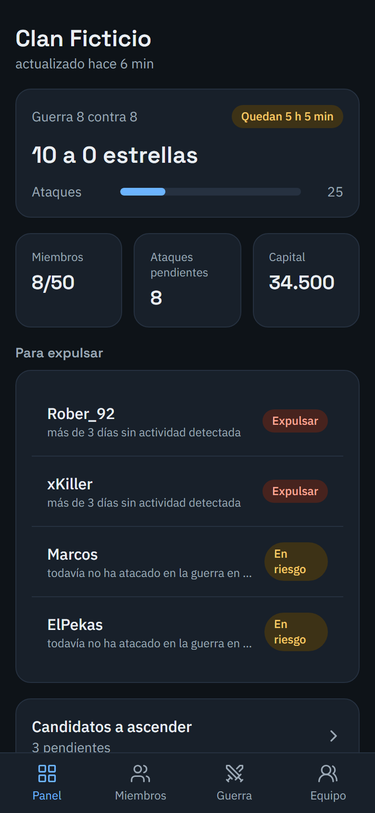
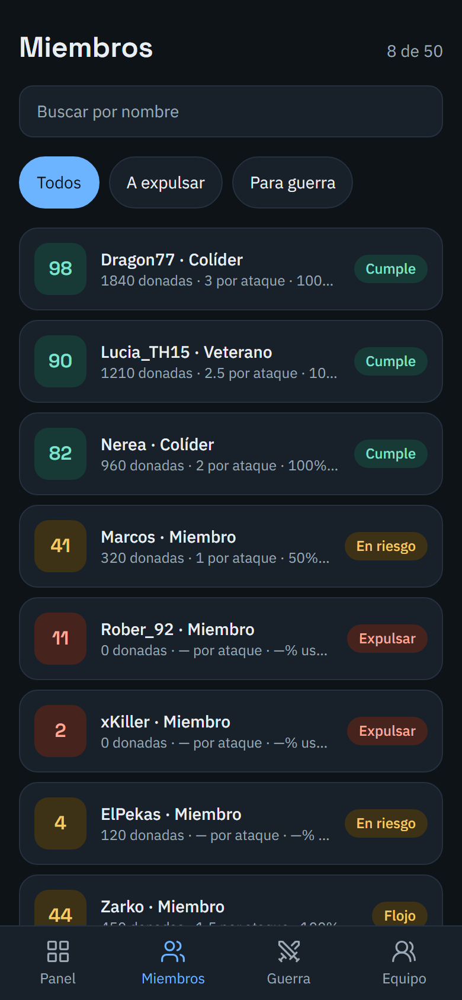
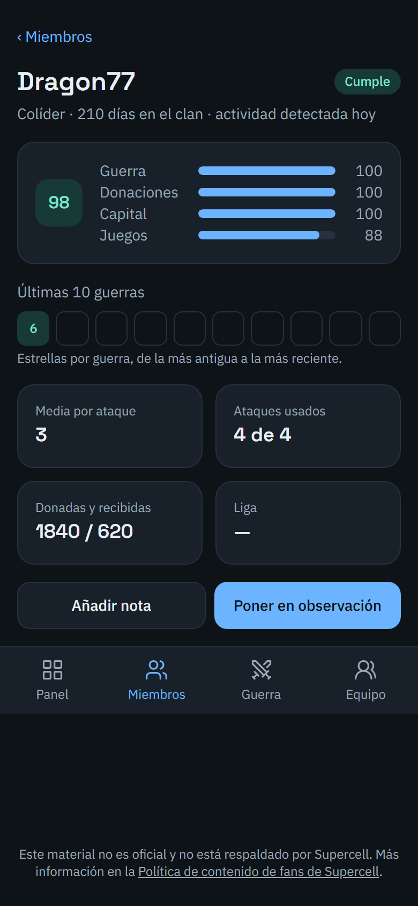
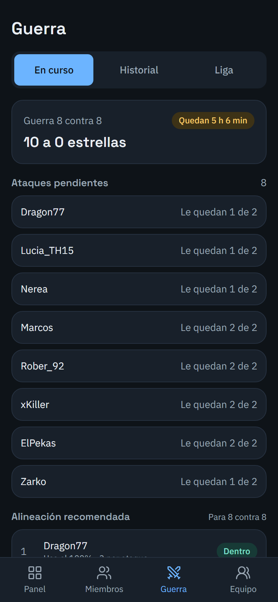
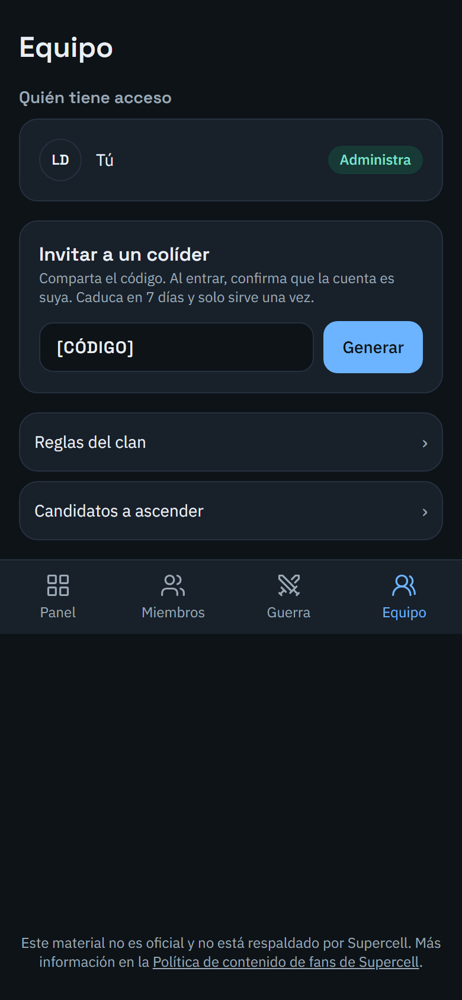
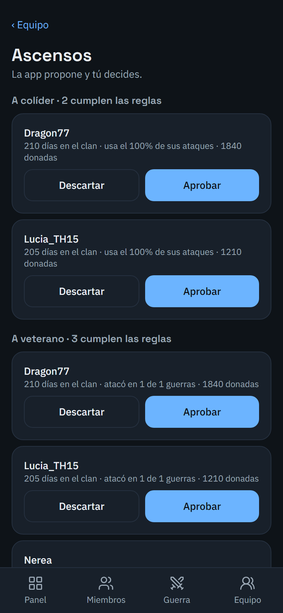
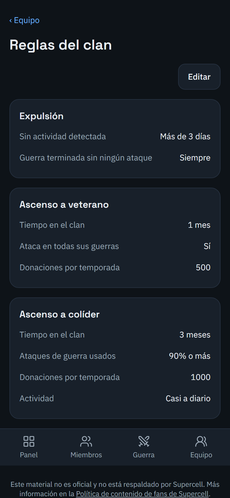

# ClashLeader

Panel de gestión para líderes de clanes de **Clash of Clans**. Recoge
automáticamente las estadísticas del clan desde la API oficial del juego y
ayuda a tomar decisiones de liderazgo —a quién expulsar, a quién ascender
y a quién convocar en guerra— con datos reales y actualizados, en vez de
hojas de cálculo o memoria.

La aplicación solo avisa y propone: expulsar y ascender se hace siempre
dentro del juego.

> Este material no es oficial y no está respaldado por Supercell. Más
> información en la [Política de contenido de fans de Supercell](https://www.supercell.com/fan-content-policy).
> ClashLeader no cobra por ningún servicio.

## Capturas

| Panel | Miembros | Ficha del miembro |
| --- | --- | --- |
|  |  |  |

| Guerra | Equipo | Ascensos | Reglas |
| --- | --- | --- | --- |
|  |  |  |  |

## Funcionalidades

- **Panel general**: estado de la guerra en curso, miembros, ataques
  pendientes, capital acumulado, miembros a vigilar y últimos movimientos
  del clan, todo en una sola vista.
- **Miembros**: listado completo con búsqueda y filtros (todos, a
  expulsar, para guerra), con el índice de rendimiento de cada uno de un
  vistazo.
- **Ficha del miembro**: índice 0–100 desglosado por guerra, donaciones,
  capital y juegos del clan; historial de las últimas 10 guerras; notas
  del líder; opción de poner a un miembro en observación.
- **Guerra**: guerra en curso con ataques pendientes y alineación
  recomendada, historial de guerras anteriores y seguimiento de Liga de
  Clanes (CWL).
- **Ascensos**: candidatos a veterano y a colíder calculados
  automáticamente según las reglas del clan, con aprobación o descarte
  manual y registro de quién decidió qué.
- **Reglas del clan**: umbrales de expulsión, ascenso y ponderación del
  índice totalmente editables por el líder.
- **Equipo y permisos**: alta de clan con verificación del líder dentro
  del juego, invitaciones de un solo uso para colíderes y control de quién
  tiene acceso a cada clan.
- **Instalable como app**: funciona como aplicación web progresiva (PWA),
  instalable en el móvil con icono propio.

## Tecnología

**Frontend**
- [Next.js](https://nextjs.org/) 16 (App Router) con TypeScript estricto
- [Tailwind CSS](https://tailwindcss.com/) 4
- [React](https://react.dev/) 19

**Backend y datos**
- [Supabase](https://supabase.com/) — PostgreSQL, Auth (correo y Google) y
  Row Level Security por clan
- Recolector en Node/TypeScript, ejecutado cada 15 minutos mediante GitHub
  Actions, que sincroniza clanes, guerras, capital y juegos del clan desde
  la API oficial de Clash of Clans
- Motor de reglas en TypeScript puro para el índice de rendimiento y las
  decisiones de expulsión y ascenso

**Calidad**
- [Vitest](https://vitest.dev/) para tests unitarios e integración
- [Playwright](https://playwright.dev/) para pruebas end-to-end contra una
  base de datos real
- [pgTAP](https://pgtap.org/) para verificar las políticas de seguridad a
  nivel de fila
- Integración continua con lint, tipado estricto, tests y auditoría de
  dependencias en cada cambio

## Arquitectura

```
 API oficial de Clash of Clans
               │
               │  el recolector sincroniza cada 15 min (Node/TypeScript, vía proxy con IP fija)
               ▼
          Supabase
 Postgres · Auth · RLS por clan
               │
               │  la aplicación lee y escribe con permisos limitados por clan
               ▼
      Aplicación web (Next.js)
```

El recolector es el único componente con credenciales de la API de Clash
of Clans y acceso completo a la base de datos; la aplicación web solo lee
y escribe con permisos limitados por clan, impuestos por la base de datos.

## Seguridad

- Acceso a los datos aislado por clan mediante Row Level Security,
  denegado por defecto y verificado con tests automatizados.
- Límite de intentos en inicio de sesión, registro, invitaciones y
  verificación de identidad.
- Cookies de sesión `HttpOnly`, `Secure` y `SameSite`, cabeceras de
  seguridad estrictas (CSP, HSTS) y registro de auditoría de las acciones
  del administrador.
- Invitaciones de un solo uso, con caducidad y almacenadas como hash.

## Puesta en marcha

Requiere Node.js 20+ y un proyecto de [Supabase](https://supabase.com/).

```bash
npm install
cp apps/web/.env.example apps/web/.env.local
# completa apps/web/.env.local con tus credenciales de Supabase y Google

npm run dev
```

La aplicación queda disponible en `http://localhost:3000`.
